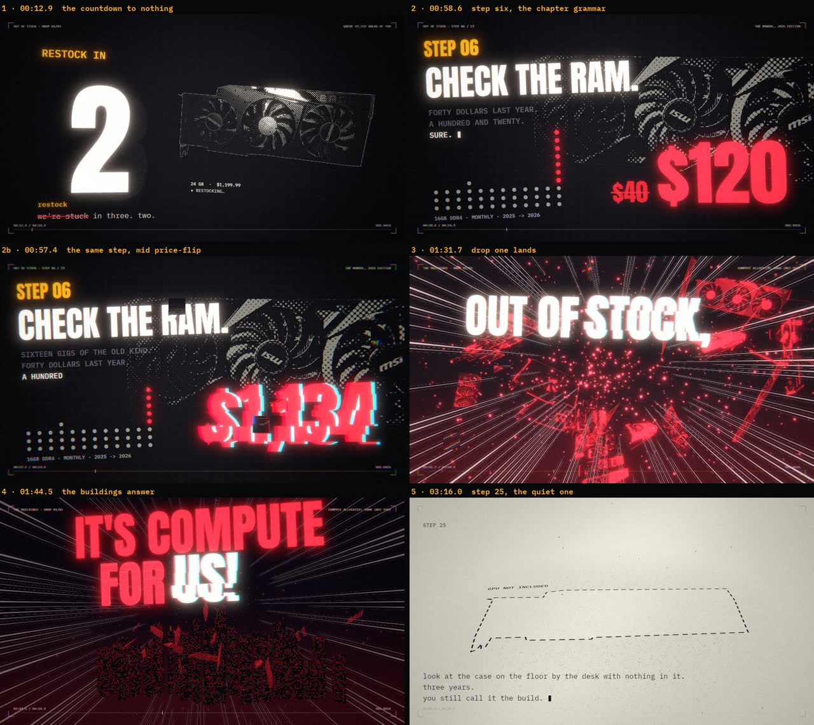
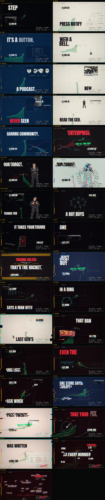
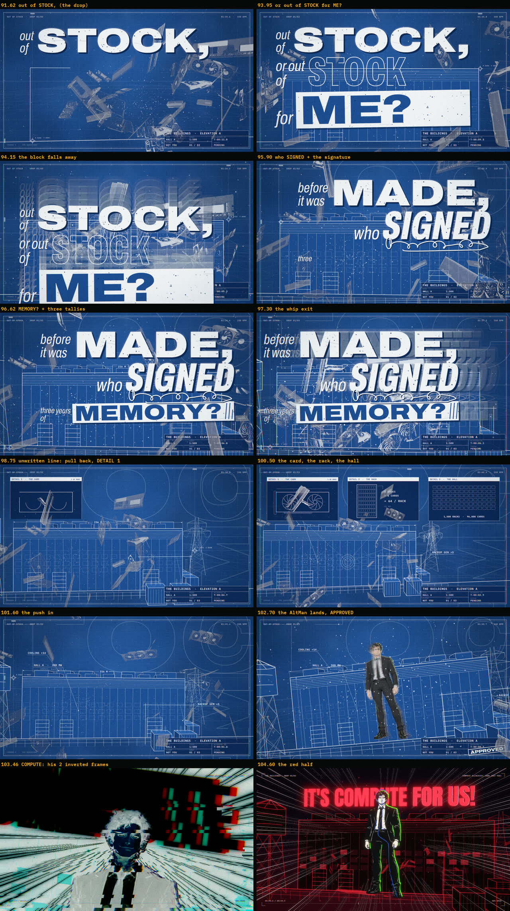

# OUT OF STOCK — a music video drawn entirely in code

A 4:05 hardstyle music video about GPU and RAM prices, rendered frame by frame by a browser from JavaScript. No video editor, no After Effects, no stock footage: every frame is a pure function of the song's time, built from the song's own data (its kicks, its sung words, its stems) and drawn with Three.js and 2D canvases, then read straight off the canvas into ffmpeg.

- **Made by:** Bleak Freq (direction, song, character art, every note that turned a rebuild) and an AI coding agent (Claude, via Claude Code) that wrote the code to that direction over seven days in September 2026.



## How it works

1. **The song becomes data.** `analysis/` turns the stems into timing: a kick map from the drum stem (`kicks.mjs` → `timing.js`, 540 kicks at 149.995 BPM), every sung word forced-aligned to the lead vocal (`align-lyrics.mjs` + `align-ctc.py` → `lyrics-aligned.json`, 688 words), the synth's spectrum and the singer's pitch per frame (`synth-spectrum.py`, `lead-voice.py` → `data/`). Nothing on screen is timed by hand.
2. **A director picks the shot.** `src/director.js` maps song time to a shot and every sync point to a word or a kick. `src/song.js` is the data contract the scenes read.
3. **Scenes draw.** The intro (`intro.js`), verse 1 as full-frame cards cut on the sung words (`fastcut.js`), verse 2 as a price chart the camera flies through with a panic meter that can only climb (`ascent.js`, `blueprint.js`, `market.js`), the choruses as a blueprint of the buildings that turns red on "COMPUTE" (`chorus.js`, `site.js`) around a rotoscoped dancer (`dancer.js`, `roto/`), verse 3's end as a sales ring coming apart on the singer's own spectrum (`meltdown.js`), and a film post chain over all of it (`post.js`). The look is a print shop: screentone, halftone, newsprint (`print.js`, `materials.js`).
4. **A browser renders, ffmpeg encodes.** `tools/render.mjs` drives the installed Edge headless, renders each frame in capture mode, reads the pixels off the canvas and pipes them to ffmpeg with the song under them.

Every frame is deterministic: the same time gives the same pixels in any render order, and the tools check that before a render is trusted.



## Running it

You need Node 20+, ffmpeg on the PATH, Microsoft Edge (the render tool drives the installed browser; change `EDGE` in `tools/render.mjs` for another Chromium), and the song as a WAV. The song is not in this repository.

```
npm install
set OOS_SONG=C:\path\to\OOM.wav        (or export OOS_SONG=... ; the default is ../suno-songs/out-of-stock/OOM.wav)
node tools/serve.mjs 5630               -> http://127.0.0.1:5630/?play   (the live preview, with the song)
node tools/render.mjs stills 57.3 104   -> stills/renders/t0057.300.png ...
node tools/render.mjs determinism 12.9 57.3 104 196.2   -> the same frames in three orders, PASS or FAIL
node tools/render.mjs video 0 245 out/out-of-stock.mp4  -> the whole video (about 12 minutes on a fast GPU)
```

Without the song the page still renders (the preview just has nothing to play); `render.mjs stills` and `determinism` never need it.

Page switches: `?t=57.3` renders one frame; `?play` is the transport; `?portrait` lays the choruses out for 9:16; `?hide=<word>` draws no words on a chorus line that contains the word.

## The toolbox

The instruments under the scenes are the reusable part:

- `tools/render.mjs` — headless stills, determinism in three render orders, presented-fps checks, and the MP4 export straight off the canvas with a per-frame hash.
- `tools/seams.mjs` — frame-to-frame change against the declared cut list, plus a camera series that catches a camera jump a picture diff can't see on a line drawing.
- `tools/motion.mjs` — a pace meter: cut rate, big-change rate, longest still stretch, for any stretch of the video.
- `tools/probe-*.mjs` — print a scene's plan from the live page (every beat, its word, its camera).
- `analysis/` — the beat grid without librosa, Whisper words pinned to syllables with wav2vec2 forced alignment, and an audio-analyzer chain (log bands, attack/decay, YIN pitch) any stem can go through.
- `tools/debrand.py` + `assets/debrand.json` — region-based logo removal with a clone-and-relight mode; `assets/make-cutouts.py` — background removal (BiRefNet) with edge cleanup that survives a halftone print; `tools/prep-assets.py` — photos to textures and outline polygons.
- `src/print.js`, `src/outline.js`, `src/blueprint.js`, `src/type.js`, `src/post.js` — the print shop, fonts as bit-exact outlines, a draughting kit, type layers with a glitch stage, and the film post chain.
- `roto/` — a green-screen clip to inked, boiling cels (`trace.py` → `trace.json`, drawn by `roto.js`), with its own page at `/roto/`.



## What is and isn't here

- **In:** the engine, the scenes as they shipped, the tools, the timing data, the prepared textures, the character art the video uses, the traced dance.
- **Not in:** the song and its stems (Suno output, the creator's), the original photos and their cutouts (see `assets/photos/CREDITS.md` for every source; `analysis/dump-stems.ps1` and the prep scripts rebuild the derived files from the sources), the review sheets, and the rejected versions of verse 2 and the chorus that the video's history went through.
- **Vocabulary in the comments:** "the creator" is the person who directed the video; "the agent" is the AI that wrote the code; "the director" is `director.js`; "the reference visualizer" is the audio-visualizer whose analyzer chain and look the intro's bars and the ring match.

## Licenses

- Code: MIT (see `LICENSE`).
- Character art and props in `characters/` and `roto/altman/`: © 2026 Bleak Freq, all rights reserved, included so the video renders.
- Photographs: Wikimedia Commons, CC BY / CC0 / public domain, modified; every source and author in `assets/photos/CREDITS.md`.
- Fonts (Anton, IBM Plex Mono, DM Serif Display, Archivo): SIL Open Font License 1.1, licenses beside them in `fonts/`.
- three.js and opentype.js: MIT, in `vendor/`. The rest of the third-party list is in `THIRD_PARTY_NOTICES.md`.
- The small orange crab that waves goodbye at the end is Claude Code's startup mascot, drawn from its terminal art.
